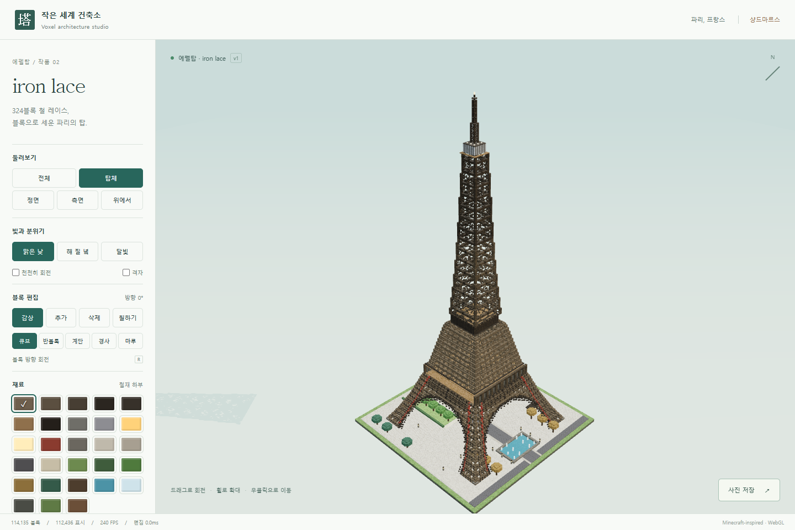

# 작은 세계 건축소 — AI Voxel Architecture Studio

AI(LLM)가 **도구로 쓰는** 마인크래프트풍 3D 블록 건축 엔진과 스튜디오입니다.
사람은 화면에서 블록을 놓고, AI는 "벽 세워 · 지붕 올려" 같은 **짧은 JSON 명령**으로 건물을 짓습니다.
AI가 블록 좌표를 하나하나 쓸 필요가 없습니다.


<sub>위 사진은 목표로 삼은 레퍼런스 화면입니다. 이 프로젝트의 예제 결과는 `examples/`의 플랜으로 직접 지어 볼 수 있습니다.</sub>

## 바로 실행 (Windows)

1. [Node.js](https://nodejs.org) 20 이상을 설치합니다.
2. `run.bat`을 더블클릭합니다. 처음 한 번은 패키지 설치 때문에 시간이 걸립니다.
3. 브라우저에서 **http://127.0.0.1:7878** 이 열립니다 (스튜디오 + AI용 API가 같은 주소).
4. 왼쪽 아래 **AI 명령 → 예제 불러오기**에서 에펠탑 · 일본 성곽 · 모던하우스 · AI 테스트 하우스를 골라 보세요.

| 파일 | 하는 일 |
|---|---|
| `run.bat` | 스튜디오 + AI API 서버 실행 (작업은 `projects/current.vox.json`에 자동 저장) |
| `mcp.bat` | AI 클라이언트(Claude Desktop, Qwen Code, LM Studio 등)용 MCP 서버 |
| `bench.bat` | **내 PC의 그래픽카드로** 성능(FPS) 측정 → 결과 표 + JSON 저장 |

## AI 연결

### 1) MCP (Claude Desktop · Qwen Code · LM Studio · OpenCode)

MCP 설정 파일에 아래처럼 넣습니다 (경로는 이 폴더 위치로 바꾸세요).

```json
{
  "mcpServers": {
    "voxel-studio": {
      "command": "node",
      "args": ["C:/path/to/Block-Create-Minecraft-Style/node_modules/tsx/dist/cli.mjs",
               "C:/path/to/Block-Create-Minecraft-Style/src/server/mcp.ts"]
    }
  }
}
```

- `run.bat`이 켜져 있으면 MCP가 그 서버를 사용합니다 → **AI가 짓는 모습이 열린 스튜디오에 실시간으로 보입니다.**
- 켜져 있지 않으면 MCP가 직접 서버를 띄웁니다. 브라우저로 http://127.0.0.1:7878 을 열면 볼 수 있습니다.
- 도구 15개: `get_guide`, `list_commands`, `describe_command`, `run_command`, `run_batch`, `execute_plan`, `get_state`, `inspect`, `render_views`, `search_assets`, `create_asset`, `modify_structure`, `history`, `save_project`, `open_project`

AI에게는 이렇게 시키면 됩니다: *"voxel-studio 도구로 get_guide를 읽고, 에펠탑을 지어 줘. 다 지으면 inspect와 render_views로 확인해."*

### 2) HTTP (어떤 프로그램·에이전트든)

```bash
curl http://127.0.0.1:7878/api/guide                      # AI용 안내서 (마크다운)
curl -X POST http://127.0.0.1:7878/api/command -H "content-type: application/json" \
     -d '{"cmd":"createTower","args":{"center":[0,0,0],"height":40,"baseSize":11,"topSize":3,"style":"lattice","material":"iron_mid"}}'
curl -X POST http://127.0.0.1:7878/api/command -H "content-type: application/json" -d @examples/house.plan.json
curl -X POST http://127.0.0.1:7878/api/command -H "content-type: application/json" \
     -d '{"cmd":"renderScene","args":{"views":["front","iso"],"labels":true}}'   # 스크린샷 -> shots/
```

### 3) 명령줄 (LLM 없이 직접)

```bash
npm run vox -- run examples/eiffel.plan.json --project projects/eiffel.vox.json --quiet
npm run vox -- inspect --project projects/eiffel.vox.json --quiet
npm run vox -- render  --project projects/eiffel.vox.json --views front,iso --out shots/eiffel --labels
npm run vox -- glb     --project projects/eiffel.vox.json --out out/eiffel.glb
```

## 무엇이 들어 있나

- **엔진**: 16³ 청크 복셀 월드, 되돌리기/다시하기, 저장(블록 스냅샷 압축 + 명령 기록), 명령 기록만으로 같은 건물 재현
- **고수준 건축 명령 14종**: 기초(석축 경사) · 바닥 · 벽(문·창 자동 배열) · 지붕(박공/모임/우진각/외쪽/평/팔작, 처마 휨) · 탑(격자 철골) · 원통 · 아치 · 트러스 · 선 · 기둥 · 계단 · 지형 · 나무 · 건물
- **참조로 위치 지정**: `{"ref":"walls","anchor":"top"}`, `{"on":{"ref":"base","inset":1}}` — 좌표 계산 불필요
- **부분 수정**: `modifyStructure {"id":"roof","args":{"pitch":0.5}}` → 지붕만 다시 짓고 나머지는 그대로
- **AI가 새 블록을 만듦**: `createShape`(숫자로 정의한 모양 → 실제 3D 형상, 검증 후 라이브러리 등록) → 다른 프로젝트에서 재사용
- **자동 검수**: 떠 있는 블록, 덮어써져 사라진 부분, 빈 구조물, 깨진 자산, 좌우 대칭 — 문제마다 고치는 명령(fixHint) 제공
- **스크린샷**: 정면·후면·좌·우·위·사선, 구조물 id 표시, 특정 구조물만 따로 찍기
- **내보내기**: 프로젝트(.vox.json), 3D 모델(.glb)

## 개발

```bash
npm install
npm test                 # 단위 테스트 (vitest)
npm run check:studio     # 브라우저 실동작 검사 (Playwright)
npx tsx scripts/check-ai.ts   # AI 연결 전체 검사 (HTTP · 실시간 연동 · 렌더 · MCP)
npm run bench:engine     # CPU 성능 측정
npm run examples         # examples/*.plan.json 다시 생성
```

설계: [`DESIGN.md`](DESIGN.md) · 진행 기록과 실측값: [`PROGRESS.md`](PROGRESS.md) · 원본 지시서: [`docs/INSTRUCTIONS.md`](docs/INSTRUCTIONS.md)
