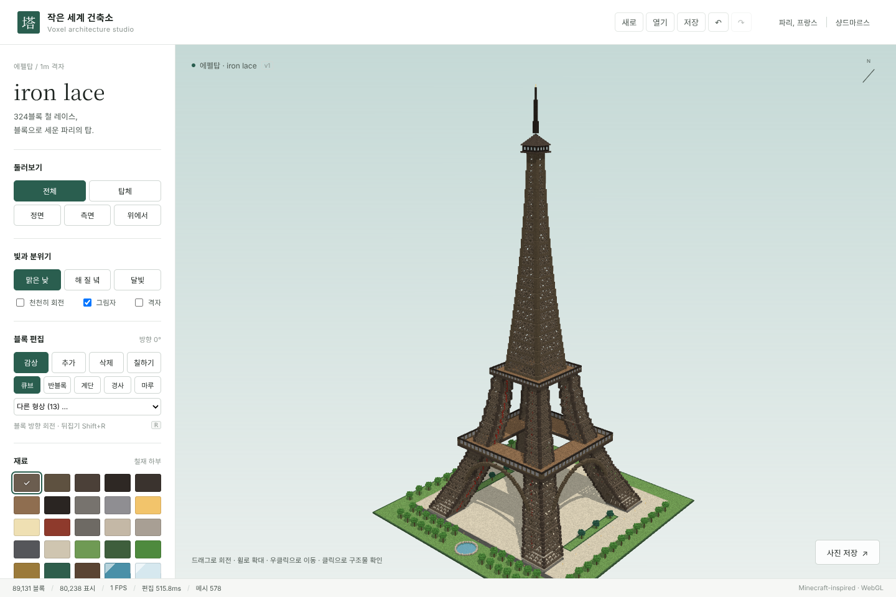
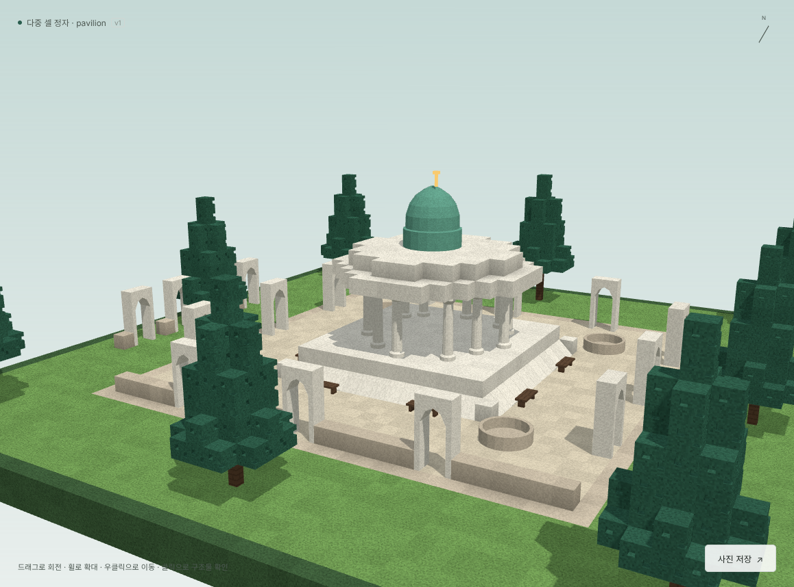
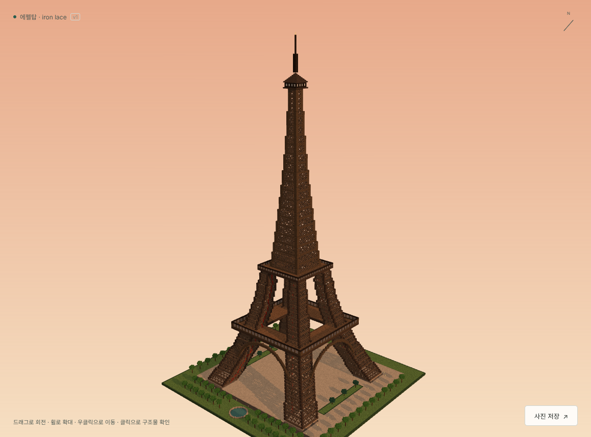
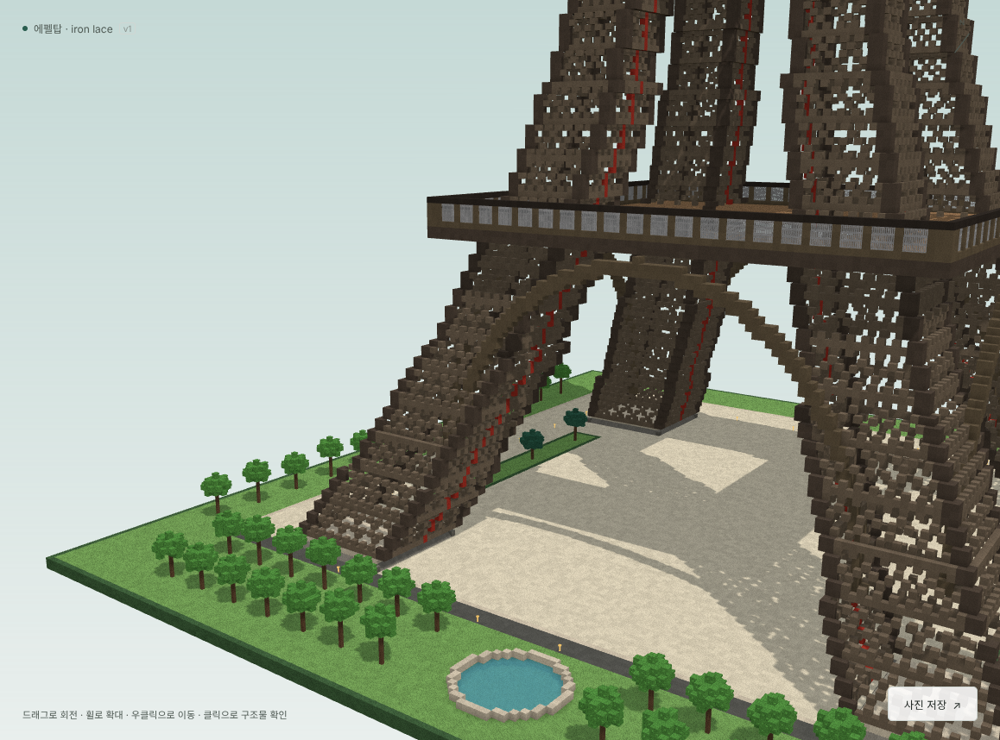
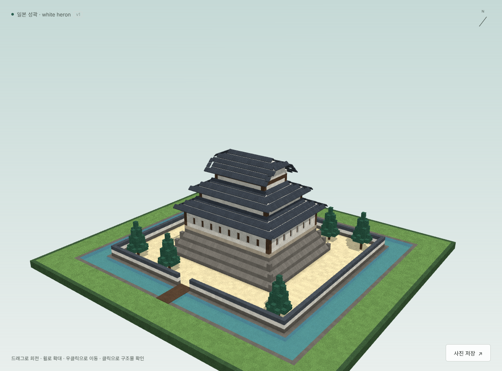
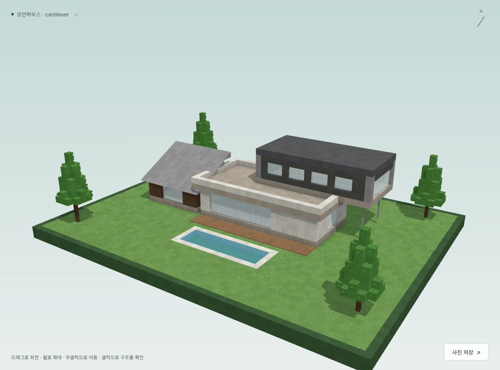
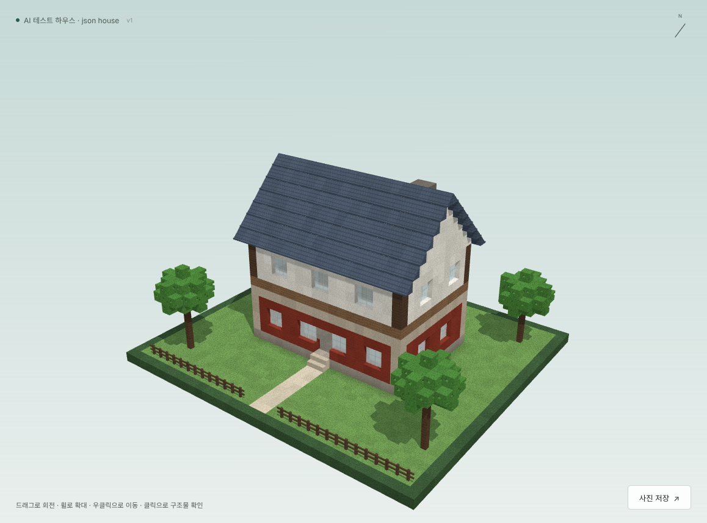
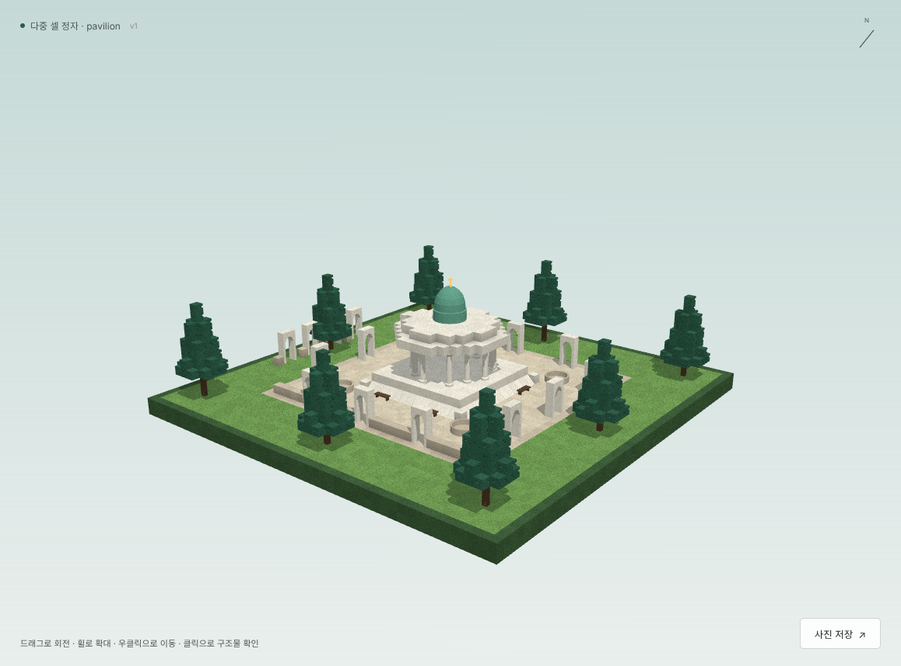
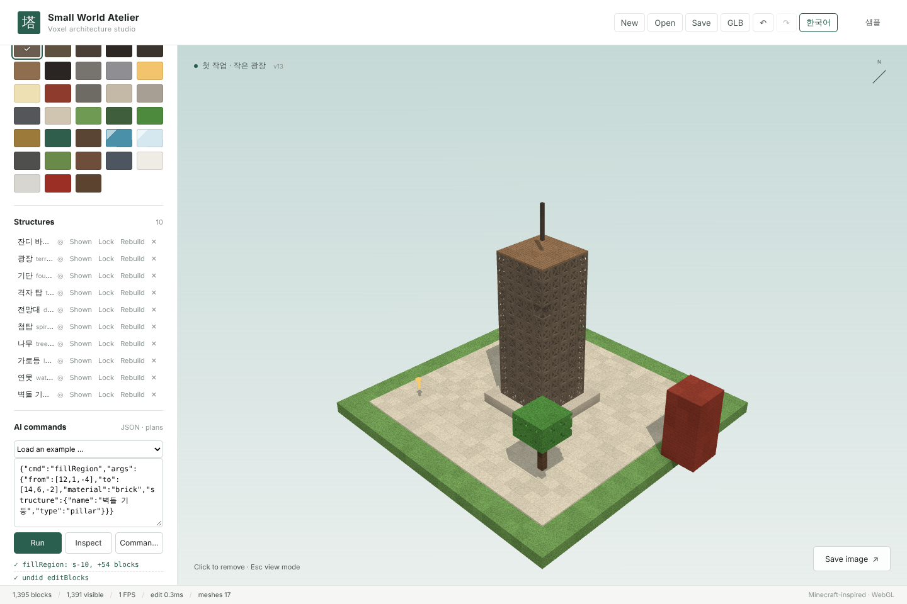

<p align="right"><b>English</b> · <a href="README.ko.md">한국어</a></p>

# Small World Atelier — AI Voxel Architecture Studio

A Minecraft-style 3D voxel building engine and studio that **AI models (LLMs) use as a tool**.
People place blocks on screen; an AI builds with **short JSON commands** such as "raise a wall" or "add a roof",
so it never has to write block coordinates one by one.

| Eiffel tower example (~120k blocks) | Multi-cell parts pavilion (2x4x1 arch · 4x4x4 dome) |
|---|---|
|  |  |

<sub>Both images were built by this program from the plans (JSON commands) in `examples/`. The reference screenshots the project started from are in `docs/ref/`.</sub>

## Gallery

| | | |
|---|---|---|
|  |  |  |
|  |  |  |

More: [`assets/showcase/`](assets/showcase/)

## Quick start (Windows)

1. Install [Node.js](https://nodejs.org) 20 or newer.
2. Double-click `run.bat`. The first start installs packages and takes a while.
3. Your browser opens **http://127.0.0.1:7878** (the studio and the AI API share this address).
4. Bottom left, **AI commands → Load an example**: Eiffel tower · Japanese castle · modern house · AI test house · multi-cell pavilion.
5. Language: the **EN / 한국어** button at the top right switches the interface (remembered; `?lang=en` in the URL also works).

| File | What it does |
|---|---|
| `run.bat` | Starts the studio + AI API server (work is autosaved to `projects/current.vox.json`) |
| `mcp.bat` | MCP server for AI clients (Claude Desktop, Qwen Code, LM Studio …) |
| `bench.bat` | Measures performance (FPS) **on your own graphics card** → results table + JSON |



## Connecting an AI

### 1) MCP (Claude Desktop · Qwen Code · LM Studio · OpenCode)

Add this to your MCP client configuration (replace the paths with this folder):

```json
{
  "mcpServers": {
    "voxel-studio": {
      "command": "node",
      "args": ["C:/path/to/Block-Create-Minecraft-Style/node_modules/tsx/dist/cli.mjs",
               "C:/path/to/Block-Create-Minecraft-Style/src/server/mcp.ts"]
    }
  }
}
```

- If `run.bat` is running, MCP uses that server (it reads the token from `.vox/token-7878.json`) → **you watch the AI build live in the open studio.**
- Otherwise MCP starts its own server; open http://127.0.0.1:7878 to watch.
- 15 tools: `get_guide`, `list_commands`, `describe_command`, `run_command`, `run_batch`, `execute_plan`, `get_state`, `inspect`, `render_views`, `search_assets`, `create_asset`, `modify_structure`, `history`, `save_project`, `open_project`

Ask the AI something like: *"Read get_guide from voxel-studio and build the Eiffel tower. When done, check it with inspect and render_views."*

### 2) HTTP (any program or agent)

The server only listens on **your own PC (127.0.0.1)**, and every request except `/api/health` needs a **token that changes on each start**.
The token is written to `.vox/token-7878.json` when the server starts (other websites cannot read it).

```bash
TOKEN=$(node -e "console.log(require('./.vox/token-7878.json').token)")
curl -H "x-vox-token: $TOKEN" http://127.0.0.1:7878/api/guide           # guide for AI agents (markdown)
curl -X POST http://127.0.0.1:7878/api/command -H "x-vox-token: $TOKEN" -H "content-type: application/json" \
     -d '{"cmd":"createTower","args":{"center":[0,0,0],"height":40,"baseSize":11,"topSize":3,"style":"lattice","material":"iron_mid"}}'
curl -X POST http://127.0.0.1:7878/api/command -H "x-vox-token: $TOKEN" -H "content-type: application/json" -d @examples/house.plan.json
```

- Requests from other sites (different Origin / Host) are refused.
- Files read or written by commands are limited to `projects/` and `out/` (`examples/` is read-only). A bare file name is saved in `projects/`.
- To make a retried request run only once, send `{"requests":[...],"opId":"unique-id"}`.

### 3) Command line (no LLM needed)

```bash
npm run vox -- run examples/eiffel.plan.json --project projects/eiffel.vox.json --quiet
npm run vox -- inspect --project projects/eiffel.vox.json --quiet
npm run vox -- render  --project projects/eiffel.vox.json --views front,iso --out shots/eiffel --labels
npm run vox -- glb     --project projects/eiffel.vox.json --out out/eiffel.glb
```

## What is inside

- **Engine**: chunked (16³) voxel world, undo/redo, saving (compressed block snapshot + command log), the same building can be rebuilt from its command log
- **Data safety**: saves are written to a temp file and swapped in (a crash mid-save keeps the old file), 3 previous versions kept (`.bak1–3`), damaged files are detected by checksum and restored from the newest good backup, the last change is saved on shutdown
- **Transactions**: a building plan is applied only if every step succeeds (on failure both the project and the shared asset library are restored); "new project + plan" is one step
- **14 high-level building commands**: foundation (sloped stone base) · floor · walls (doors and window rows) · roofs (gable / hip / pyramid / shed / flat / irimoya, upturned eaves) · towers (iron lattice) · cylinder · arch · truss · line · pillar · stairs · terrain · trees · building
- **Positions by reference**: `{"ref":"walls","anchor":"top"}`, `{"on":{"ref":"base","inset":1}}` — no coordinate math
- **Partial changes**: `modifyStructure {"id":"roof","args":{"pitch":0.5}}` rebuilds only the roof
- **AI-made blocks**: `createShape` (a shape described with numbers → real 3D geometry, validated, saved to the library) → reused in other projects
- **Multi-cell parts (Procedural Asset Engine)**: parts from 1×1×1 up to 16×16×16 (e.g. a 2×4×1 arch, 1×4×1 column, 4×4×4 dome). Rotation swaps width and depth, collision policies (replace / skip / error), removing any covered cell removes the whole part, saving / loading / undo / rendering (one instance per part) all supported. Repeat them with `placeShape` layouts (grid · line · ring) and reuse groups as components
- **Automatic inspection**: floating blocks, parts lost to later structures, empty structures, broken assets, mirror symmetry — every issue comes with a fix command (fixHint)
- **Screenshots**: front · back · left · right · top · iso, structure id labels, single structures in isolation
- **Export**: project (.vox.json), 3D model (.glb)
- **Korean / English interface**

## Development

```bash
npm install
npm test                 # unit tests (vitest)
npm run check:studio     # real browser checks (Playwright)
npm run check:ai         # end-to-end AI checks (HTTP · live sync · rendering · MCP)
npm run bench:engine     # CPU performance
npm run examples         # regenerate examples/*.plan.json
```

Testing on Windows / RTX 5090: [`docs/WINDOWS_TEST.en.md`](docs/WINDOWS_TEST.en.md) ([한국어](docs/WINDOWS_TEST.md))

Design (Korean): [`DESIGN.md`](DESIGN.md) · progress log and measurements (Korean): [`PROGRESS.md`](PROGRESS.md) · original brief: [`docs/INSTRUCTIONS.md`](docs/INSTRUCTIONS.md)

> The example plans in `examples/` keep their Korean structure names and descriptions (they are project data); the interface, the AI guide and all engine messages are in English.

## License & source attribution

This project's original software is released under the [MIT License](LICENSE).

**When redistributing the software or substantial portions of it, retain the MIT copyright and permission notices**, including the original repository URL in the copyright notice:

```text
Copyright (c) 2026 ssain3d-lgtm (original source: https://github.com/ssain3d-lgtm/Block-Create-Minecraft-Style)
```

If you build on this project, a visible credit in your README or project documentation is appreciated:

> Based on [Small World Atelier — AI Voxel Architecture Studio](https://github.com/ssain3d-lgtm/Block-Create-Minecraft-Style) by ssain3d-lgtm.

The visible credit is a request, **not an additional license condition**; the standard MIT license does not require an in-app credit or a prominent link. Third-party reference images under `docs/ref/` are not represented as MIT-licensed by this project's copyright holder; check their separate rights before reusing them.
